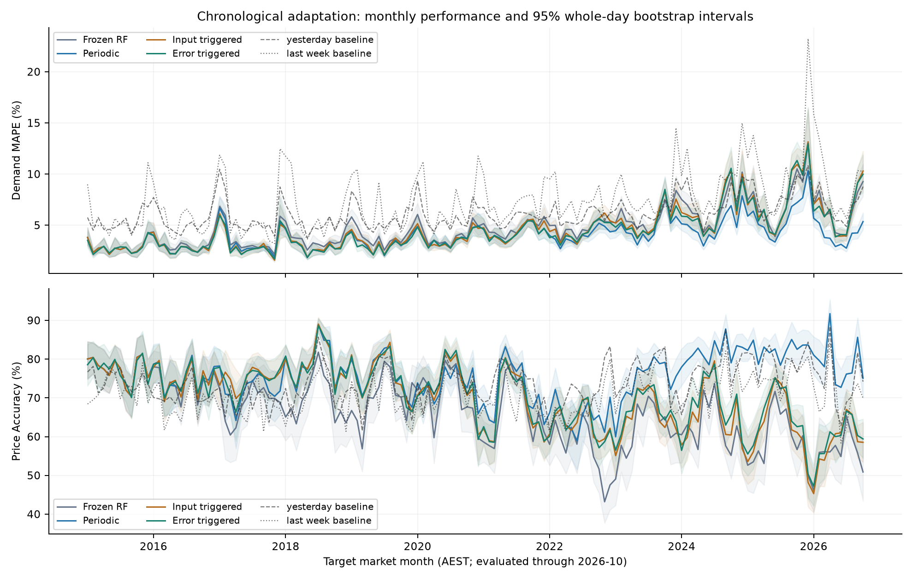
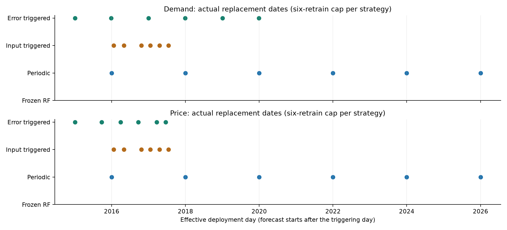
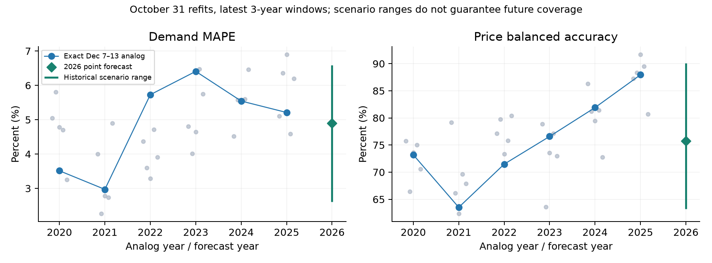

# Part E review evidence

Selected machine-generated tables, figures and checks are committed here so
the group can inspect them without downloading the full local results. These
are implementation/results evidence, not report text. The raw released CSV,
trained model weights and interval-level prediction dumps are not included.

## Historical comparison: 2015-01-01 to 2026-10-31

| Method | Demand MAPE (%) | Price balanced accuracy (%) | Retrains per task |
| --- | ---: | ---: | ---: |
| Yesterday baseline | 6.150 | 73.42 | 0 |
| Last-week baseline | 7.422 | 70.42 | 0 |
| Frozen RF | 4.737 | 63.57 | 0 |
| Periodic RF | 3.940 | 74.41 | 6 |
| Input-triggered RF | 4.500 | 68.86 | 6 |
| Error-triggered RF | 4.394 | 69.16 | 6 |

- [Overall metrics](overall_performance.csv), [yearly metrics](yearly_performance.csv),
  [monthly metrics](monthly_performance.csv), [cost comparison](strategy_cost_comparison.csv).
- [Both monthly interval methods](monthly_confidence_intervals.csv): normal
  independent-half-hour bounds and2000whole-day bootstrap replicates.
- [Independent verification](verification.json): eight series,4322days each,
  with1704monthly interval rows.2026annual results include January–October only.

## Figures

Other PNG/PDF pairs in[figures/](figures/): price balanced accuracy, budget versus
performance, interval widths and detector statistics. Error/input alarms may
continue after the replacement budget is exhausted. See source documentation
for the fixed thresholds, reference periods and next-day activation rule.

## Final candidate checks

- Final training:2023-11-01 through2026-10-31,52608rows, published B/C RF settings.
- Artifacts:46.50MiB, lossless compression.
- [Official local ZIP check](check_submission.log):14/14days passed.
- [Independent reconstruction](reproducibility_check.json): identical model-file SHA256.
- [Local runtime](runtime_check.json): around755MiB peak RSS on macOS.
- Linux/resource-isolated sandbox has not been verified here. The14checker days
  were in final training; their scores are not live-week estimates.

The candidate ZIP and full handover archive are distributed separately. The
group's designated packager should run the official checker again on Linux and
after integration. See[handover](../HANDOVER.md).

## Live-week forecast evidence

- [Forecast calculations](live_forecast_evidence.csv),
  [six same-date analog weeks](live_same_date_week_metrics.csv),
  [thirty nearby weekly scenarios](live_nearby_week_scenarios.csv),
  [assumptions and limits](live_summary.json).
- Declared point estimates: demand MAPE4.896%, price balanced accuracy75.773%.
- Historical scenario percentiles: MAPE2.611–6.589%, balanced accuracy63.237–90.077%.
  These empirical ranges do not guarantee95%future coverage. Strategy selection,
  dependence between weeks/years, regime changes and idealized weather are documented.

[File hashes](manifest.json) identify the selected published evidence. Reproduction
commands are in the[Part E README](../README.md).
